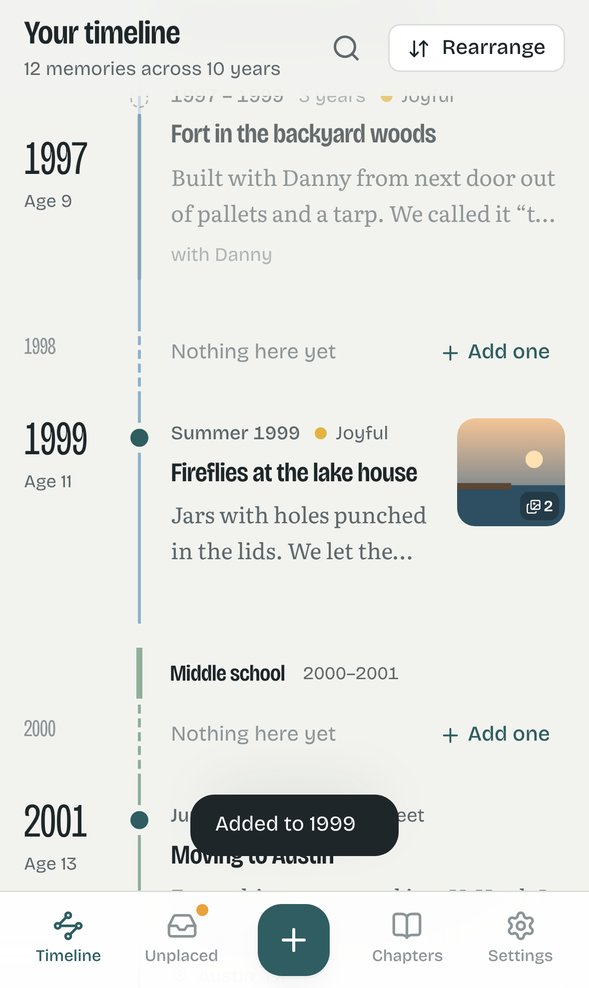
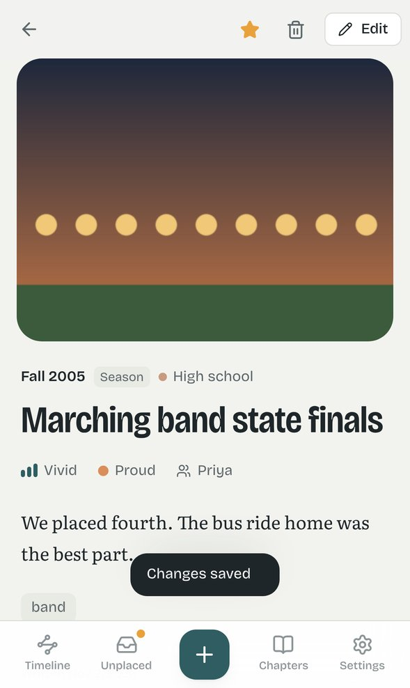
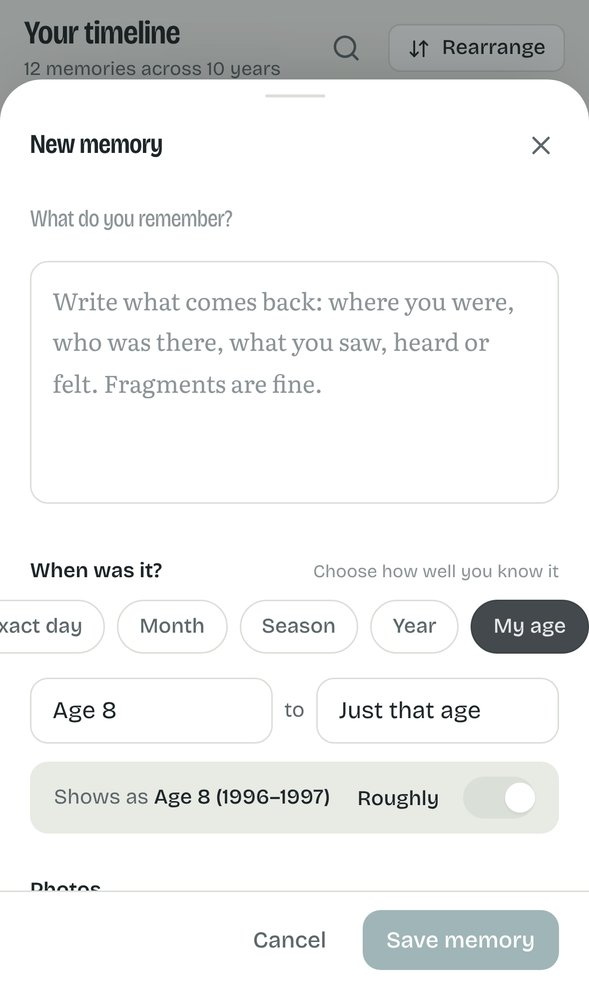
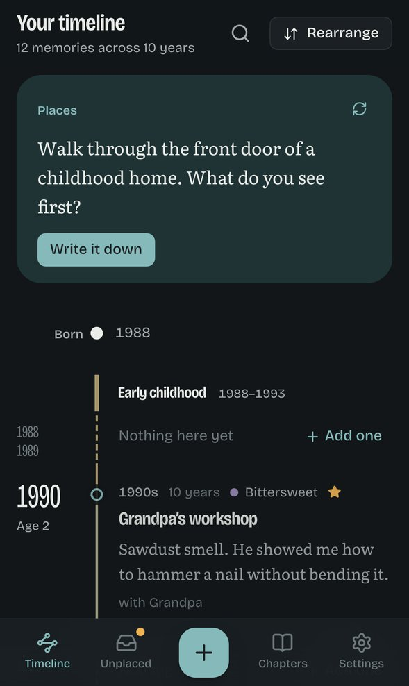
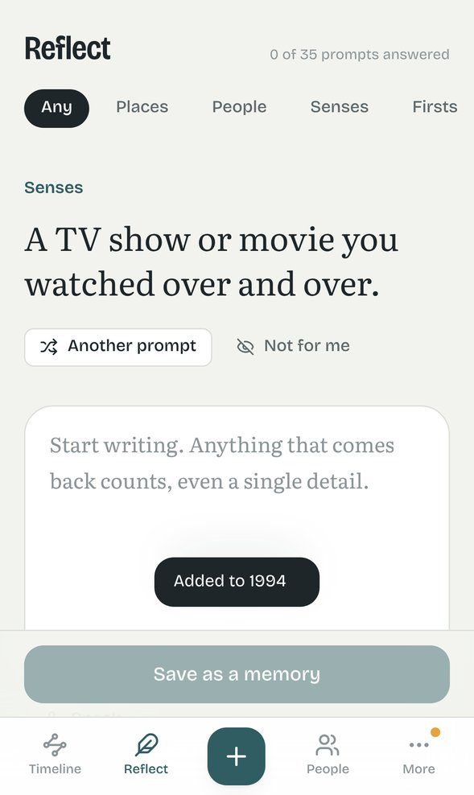
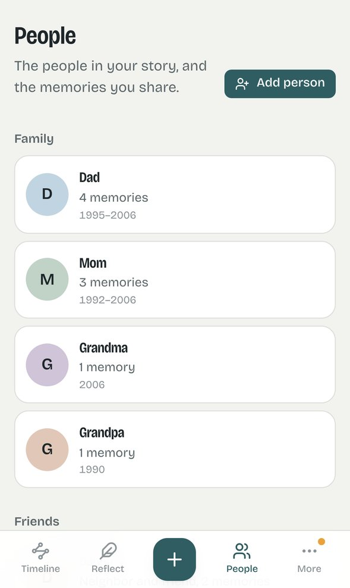
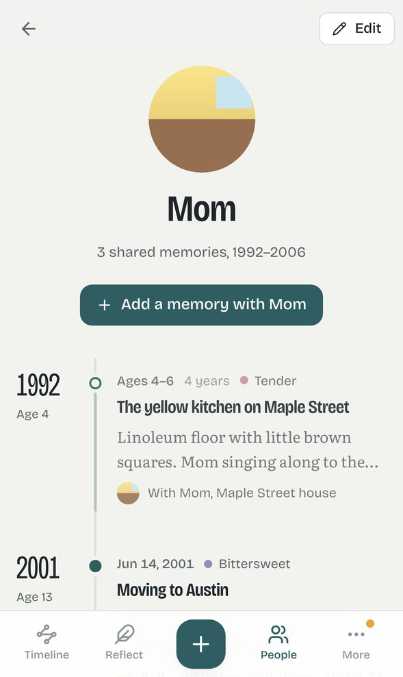
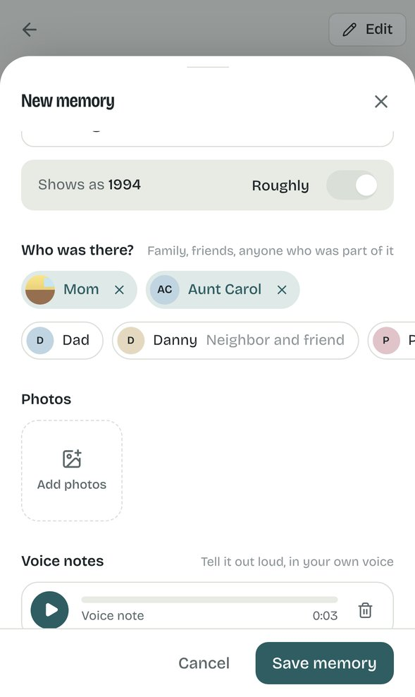
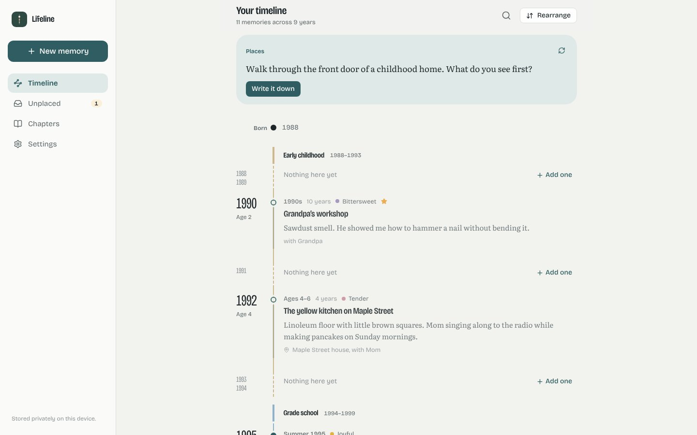

# Lantern

Bring your past back into the light. Capture memories as they come back, place them on the timeline of your life, and get help with the years that are still quiet.

Lantern is for people who want to rebuild a picture of their past, including people who don't remember much of it. Memories often come back as fragments with no date. The app lets you write them down in seconds, file them as precisely or loosely as you actually know, and rearrange them as more comes back.

One codebase runs **on the web** and **on iOS** (wrapped with Capacitor).

<p>
  
  
  
  
</p>
<p>
  
  
  
  
</p>


---

## What's in it

| Area | What it does |
| --- | --- |
| **Timeline** | Year-by-year spine with sticky year numerals, your age in each year, chapter colors, "Born" and "Today" markers, and a decade jump bar. |
| **Fuzzy dates** | Exact day, month, season, year, *my age* ("ages 8–10"), between years, decade, or *not sure yet*. Plus a **Roughly** toggle for "around…". |
| **Clarity** | Each memory is marked vivid, partial or faint, and drawn that way: faint memories are lighter, with an open dashed dot and a softened photo. |
| **Rearrange** | Drag memories into the order you remember them. Dropping one into another year re-dates it, with **Undo**. Exact-day memories are pinned. "Sort by date" resets a year. |
| **Unplaced** | An inbox for memories with no date yet. One-line quick capture, then **Place it** later. |
| **Remembered or told** | Every memory records where it comes from: you remember it, someone told you (and who), you know it from a photo or video, or some of each. Psychologists call this remembering versus knowing. Told and recorded memories are labeled and can be filtered, so what you recall stays distinct from what you've heard. |
| **Gap prompts** | Empty stretches of the timeline show what you know about those years (where you lived, your grade, milestones) and a **Help me remember** button. It opens Reflect focused on that stretch, with prompts built from your age, your life frame, people from nearby memories, and the memories on either side. Long gaps are split by stage of life. Reflect also points out the quietest stretch of your timeline. Prompts ask open questions and never suggest what happened. |
| **Reflect** | A focused writing screen: one prompt at a time, **Another prompt** to shuffle, a theme filter, and **Not for me** to retire a prompt. Writing is saved as a draft per prompt, so shuffling never loses anything. **Save as a memory** carries your writing into the editor with a suggested title and age range, where you add the date, people and photos. 35 prompts on places, people, senses, firsts, everyday life and milestones. |
| **People** | Family and friends as real records with a relationship ("Mom", "Best friend") and an optional photo. "Who was there?" in the editor, avatars on the timeline, a People directory grouped into Family, Friends and Others, a page for each person with every shared memory in order, and filtering the timeline by person. |
| **Voice** | **Dictation** (speak and it types) in the editor, on Reflect and in quick capture. **Voice notes**: record yourself telling a memory and keep the audio with it. |
| **Life frame** | Reference points memories hang on, an idea borrowed from the "life history calendar" researchers use to improve recall. Stages of life (school years, decades), homes, work, relationships and milestones. Lantern suggests school stages and common milestones from your birth year. Stages color the timeline spine; homes, work, milestones and your school grade show alongside each year. |
| **Photos** | Pick from the phone's photo library or take a picture: the iOS picker offers Photo Library, Take Photo and Choose File. Photos are downscaled on the device, and the capture date is read from the photo's EXIF data and offered as the memory's date. |
| **Details** | Place and tags (autocompleted from what you've used before), feeling, favorites, and **Keep it covered** for memories you don't want shown on the timeline. |
| **Search** | Full-text search across titles, notes, places, people and tags, with favorite and feeling filters. |
| **Privacy and data** | Everything is stored on the device (IndexedDB). Back up and restore as a single JSON file, including photos, people and voice notes. Older backups are upgraded automatically. |
| **Polish** | Light and dark themes, iOS safe areas, a bottom sheet on phones and a dialog on desktop, keyboard-accessible drag and drop, reduced-motion support. |

## Tech stack

- **React 19 + TypeScript + Vite**
- **Tailwind CSS v4**, with design tokens in `src/index.css`
- **Dexie** (IndexedDB) for local-first storage, plus `dexie-react-hooks` for live queries
- **@dnd-kit** for touch, mouse and keyboard drag and drop
- **Web Speech API** for dictation on the web, and **@capacitor-community/speech-recognition** (Apple's Speech framework) in the iOS app
- **MediaRecorder** for voice notes
- **Capacitor 8** for the iOS app
- **Vitest** + `fake-indexeddb` for unit tests
- Fonts are bundled, so the app works offline: Bricolage Grotesque (interface and year numerals) and Literata (memory text)

## Getting started

```bash
npm install
npm run dev        # http://localhost:5173
npm test           # unit tests (date model, ordering, storage)
npm run build      # production build into dist/
```

On first launch, choose **Look around with a sample life first** to see a populated timeline.

## Deploying the web app

`.github/workflows/deploy.yml` runs the type check, tests and build on every push and pull request. Pushes to `main` deploy to Cloudflare Pages, and pull requests get a preview URL posted as a comment.

One-time setup:

1. In Cloudflare, create an API token with the **Cloudflare Pages: Edit** permission (My Profile → API Tokens → Create Token).
2. In GitHub, add two repository secrets (Settings → Secrets and variables → Actions):
   - `CLOUDFLARE_API_TOKEN`: the token from step 1
   - `CLOUDFLARE_ACCOUNT_ID`: shown in the Cloudflare dashboard under Workers & Pages
3. Push to `main`. The first run creates the `lantern-memories` Pages project and deploys to `https://lantern-memories.pages.dev` (Cloudflare adds a suffix if that name is taken). Add a custom domain in the Pages project settings.

`public/_headers` sets security headers and long-term caching for the hashed build assets.

## Running on iOS

Requirements: a Mac with Xcode 16+ and an Apple Developer account (needed for devices and the App Store).

```bash
# one time
npm run ios:add          # generates the native ios/ project. Commit it.

# every time you change web code
npm run ios:sync         # builds and copies into the iOS project
npm run ios:open         # opens Xcode, then press Run
```

Before you ship:

1. Change `appId` in `capacitor.config.ts` to your own bundle id (e.g. `com.yourname.lantern`).
2. In Xcode, set your team under *Signing & Capabilities*.
3. Add these usage strings to `ios/App/App/Info.plist`. iOS shows them when it asks for permission, and the app crashes without them:

   ```xml
   <key>NSPhotoLibraryUsageDescription</key>
   <string>Lantern lets you add photos to your memories.</string>
   <key>NSCameraUsageDescription</key>
   <string>Lantern lets you take a photo for a memory.</string>
   <key>NSMicrophoneUsageDescription</key>
   <string>Lantern uses the microphone for dictation and voice notes.</string>
   <key>NSSpeechRecognitionUsageDescription</key>
   <string>Lantern turns what you say into text so you can write memories by speaking.</string>
   ```
4. Generate the iOS app icons from `assets/icon-only.png` (1024×1024, already included):

   ```bash
   npx @capacitor/assets generate --ios
   ```

   The web app uses `public/icon.svg`, the same mark with rounded corners.

## Project structure

```
src/
  types.ts                 Domain model: Memory, FuzzyDate, Chapter, Settings
  db/
    db.ts                  Dexie schema
    repo.ts                All writes. Keeps derived sort fields consistent.
  lib/
    fuzzyDate.ts           Resolve, format and shift fuzzy dates
    ordering.ts            Year sections, manual ranks, gap detection
    images.ts              Downscale, thumbnail, EXIF date
    backup.ts              Export and import (JSON, photos as base64)
    prompts.ts             Reflection prompts, shuffling, title suggestions
    speech.ts              Dictation (web + native) and voice note helpers
    sample.ts              Sample life for first-run exploration
  components/              UI building blocks, editor, date picker, rearrange list
  state/                   Editor and toast state, shared people lookup
  screens/                 Timeline, Reflect, People, Person, Memory, Unplaced, Chapters, Settings, More, Onboarding
```

## How uncertain dates and reordering work

Every memory stores its `FuzzyDate` as you entered it. From that the app derives:

- `sortStart` / `sortEnd`: concrete ISO bounds. "Summer 1998" becomes Jun 1 to Aug 31; "age 8" becomes birth year + 8 to + 9.
- `groupYear`: the year section it's filed under (the start year), or `null` if unplaced.
- `rank`: an optional manual position within its year.

Within a year, memories are ordered by date until you rearrange them. Then every memory in that year gets a spaced numeric rank, and later moves write a single midpoint rank. New memories added to an arranged year are merged in by date, so your manual order is never lost. Dragging a memory into another year shifts its date while keeping its precision: a "season" stays a season, an age range shifts by the same number of years, and dropping a range onto a year inside it narrows the range. Changing your birth year re-files age-based memories automatically.

## Data migrations

When the app was renamed (Lifeline → Driftwood → Lantern), its local database name changed too. On first launch Lantern copies any data saved under an older name on the same device, and leaves the old copy in place.

The database is versioned with Dexie. Version 2 turned the plain name tags from version 1 into People records, matching names case-insensitively, and added voice notes. It runs automatically the first time an existing user opens the new version. Backups carry their own version number and are upgraded the same way on import.

## Ideas for expanding it

**Near term**
- **Transcribe voice notes.** Turn a recorded note into text after the fact, on the device with Apple's Speech framework or with Whisper.
- **Hands-free capture.** An iOS Shortcut or Siri intent ("Hey Siri, add a memory to Lantern") that opens straight into dictation.
- **Face ID lock** (`capacitor-native-biometric`) and an encrypted database option for an app that may hold sensitive material.
- **"On this day" and gentle reminders.** Optional local notifications with a prompt, at a time you choose.
- **Photo-first capture.** Pick a batch of old photos and get one draft memory per photo, pre-dated from EXIF.
- **Native share and export** through `@capacitor/share` and `@capacitor/filesystem`, plus a PDF "life story" export arranged by chapter.

**Bigger features**
- **Optional encrypted sync** across devices (CloudKit on iOS, or Supabase with client-side encryption). The JSON backup format is already the migration path.
- **Ask family.** Send a link so a parent or sibling can add a memory or a photo from their side, which then shows up as a suggestion to accept.
- **Share with a therapist.** A read-only, time-limited link to selected memories or a chapter.
- **Map view** of places, and **family trees**: link people to each other (Grandma is Mom's mother) and browse memories by branch.
- **Prompts about specific people.** "What did Grandpa's voice sound like?", generated from the people you've added.
- **Memory threads** that link related memories ("the lake house" across many summers), shown as connected dots on the timeline.
- **AI-assisted recall (opt-in).** Follow-up questions about a memory you've written, or prompts drawn from the gaps in your timeline. Keep this strictly opt-in and transparent, given how personal the content is.
- **Home-screen widget** with a daily prompt.

**Product and launch**
- Write the App Store privacy label as "Data not collected": the app has no analytics or network calls.
- Get a clinician's review of prompt wording and of how difficult memories are handled. Consider an optional "If this brings up something hard" resources screen.
